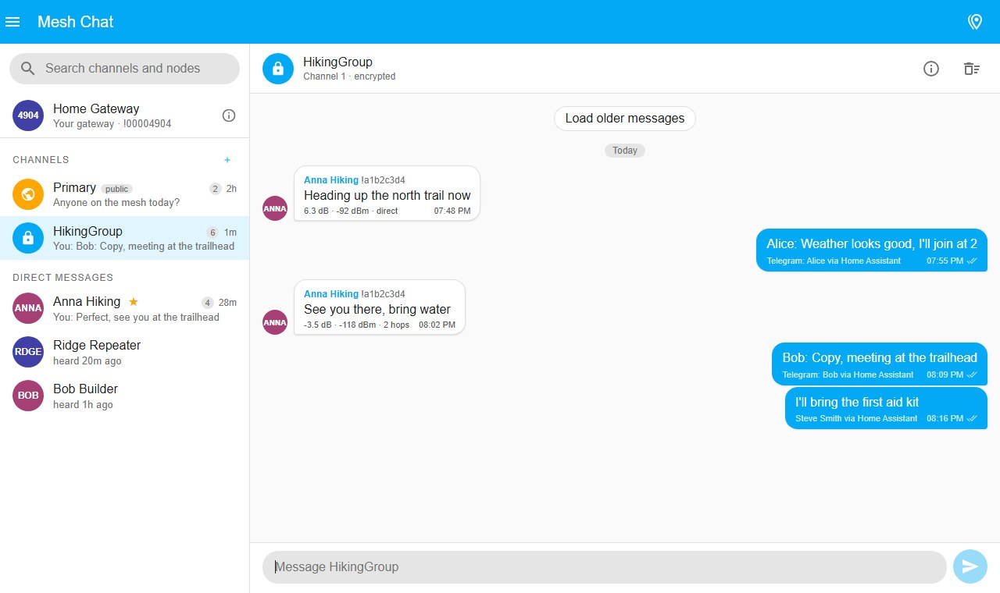
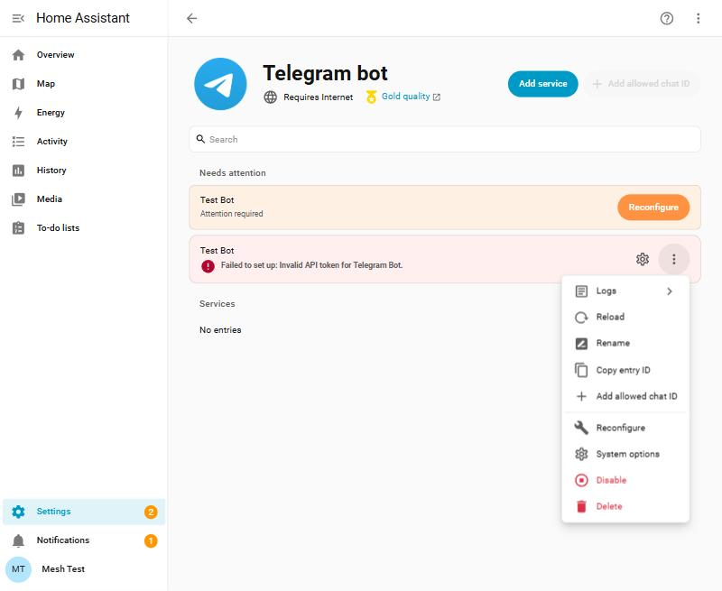
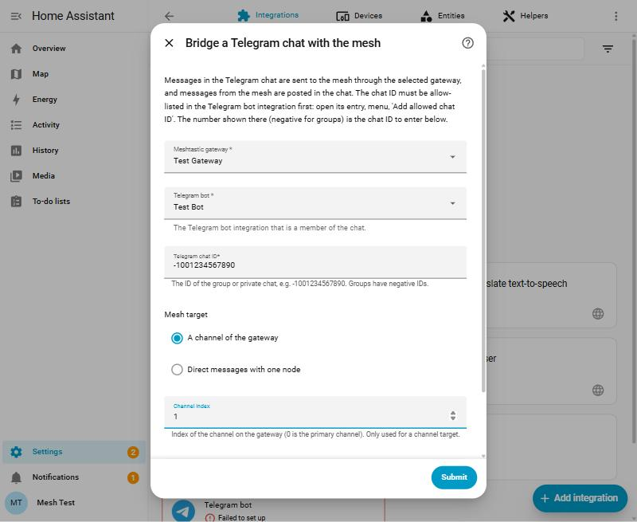

<p align="center"></p>

# Meshtastic Telegram Bridge

A Home Assistant integration that links a **Telegram chat** with a **Meshtastic channel or node**, through the
[Meshtastic integration](https://github.com/meshtastic/home-assistant) and Home Assistant's built-in
[Telegram bot integration](https://www.home-assistant.io/integrations/telegram_bot/).

- Messages written in the Telegram chat are sent over the mesh by your gateway, as `Alice: on my way`.
- Messages received over the mesh are posted in the Telegram chat, as **📡 Anna Hiking**: on my way.
- Messages sent from Home Assistant (the Mesh Chat panel, automations, another bridge) are posted too, shown as
  coming from the gateway node, exactly as other mesh users see them.
- One bridge links one chat with one channel (or one node for direct messages). Add the integration again for more.

<p align="center"></p>

## Contents

1. [How it works](#how-it-works)
2. [Requirements](#requirements)
3. [Installation](#installation)
4. [Setup, step by step](#setup-step-by-step)
5. [Options](#options)
6. [What the messages look like](#what-the-messages-look-like)
7. [Limits and risks](#limits-and-risks)
8. [Troubleshooting](#troubleshooting)
9. [Removing the bridge](#removing-the-bridge)

## How it works

The bridge holds no connection of its own. It listens to the events of two integrations that are already set up and
calls their actions:

| Direction | Source | Target |
|---|---|---|
| Telegram → mesh | `telegram_text` event of the Telegram bot integration | `meshtastic.send_text` action of the Meshtastic integration |
| Mesh → Telegram | `meshtastic_api_text_message` event (received over the radio) and `meshtastic_chat_message_sent` event (sent from Home Assistant) | `telegram_bot.send_message` action |

Nothing is stored by the bridge except its settings: the bot token stays in the Telegram bot integration and the
gateway connection in the Meshtastic integration.

## Requirements

| Dependency | Needed for | Notes |
|---|---|---|
| Home Assistant 2025.7 or newer | the Telegram bot integration's config entries | older versions are not supported |
| [Meshtastic integration](https://github.com/meshtastic/home-assistant) with a gateway | sending and receiving on the mesh | any version works for radio messages |
| Meshtastic integration, **Mesh Chat test build 5** or newer | showing bridged messages in the Mesh Chat panel and mirroring messages sent from Home Assistant | install from [rdkmedia0/home-assistant](https://github.com/rdkmedia0/home-assistant/releases) through HACS |
| [Telegram bot integration](https://www.home-assistant.io/integrations/telegram_bot/) (built in) | talking to Telegram | set up with the *Polling* platform, no public URL needed |
| A Telegram bot token | the Telegram bot integration | created with @BotFather, see below |

## Installation

### With HACS (recommended)

1. HACS → ⋮ (top right) → **Custom repositories**.
2. Repository: `https://github.com/rdkmedia0/meshtastic-telegram-bridge`, type: **Integration**, add.
3. Search HACS for **Meshtastic Telegram Bridge**, download the latest version.
4. Restart Home Assistant.

### Manually

Copy the folder `custom_components/meshtastic_telegram_bridge` of this repository into the `custom_components`
folder of your Home Assistant configuration and restart Home Assistant.

## Setup, step by step

### 1. Create a Telegram bot

1. In Telegram, open a chat with **@BotFather**. It is the official account: username exactly `@BotFather`,
   verified tick, millions of users. Copycats exist, so use the link https://t.me/BotFather.
2. Send `/newbot`, pick a display name and a username ending in `bot`. BotFather answers with the **token**
   (`123456789:AAH...`). Treat it like a password.
3. For a **group** chat, let the bot see every message: send `/mybots`, choose the bot, **Bot Settings → Group
   Privacy → Turn off**. If the bot is already in the group, remove and re-add it afterwards.

### 2. Add the Telegram bot integration in Home Assistant

1. Settings → Devices & services (called **Devices** in newer versions) → **Add integration** → *Telegram bot*.
2. Platform: **Polling**. Paste the token. Leave the other fields at their defaults.

### 3. Allow the chat and find its ID

1. In Telegram, add the bot to the group (or open a private chat with it) and send any message there.
2. In Home Assistant open the **Telegram bot** integration, then the ⋮ menu of the bot's entry →
   **Add allowed chat ID**. Home Assistant suggests the ID of the chat the bot just heard from: a negative number
   for groups, e.g. `-1001234567890`. Accept it, and keep the number, the bridge needs it too.

<p align="center"></p>

Home Assistant ignores messages from chats that are not on this list, so this step is required. If no ID is
suggested, the bot did not receive the message: check the privacy setting above, or get the ID with `@getidsbot`.

### 4. Add the bridge

Settings → Devices & services → **Add integration** → *Meshtastic Telegram Bridge*.

<p align="center"></p>

| Field | What to enter |
|---|---|
| Meshtastic gateway | the gateway whose channel or node is bridged |
| Telegram bot | the bot from step 2 |
| Telegram chat ID | the number from step 3, including the minus sign |
| Mesh target | **A channel of the gateway** to bridge a channel, or **Direct messages with one node** |
| Channel index | the channel's index on the gateway: 0 is the primary channel, 1 the first secondary channel. Only used for a channel target |
| Node | only for a node target: the node's user ID (`!a1b2c3d4`) or node number. Leave empty for a channel |

Submit. Write something in the Telegram group: it appears in the Mesh Chat panel and goes out over the radio.
Send from a node on that channel: it appears in the group.

## Options

Open the bridge's entry → **Configure**.

| Option | Default | Description |
|---|---|---|
| Direction | Both | Only forward Telegram to the mesh, only the mesh to Telegram, or both |
| Prefix mesh messages with the Telegram sender's first name | on | `Alice: on my way` on the mesh |
| Prefix Telegram messages with the mesh node's name | on | **📡 Anna Hiking**: on my way in Telegram |
| Telegram messages longer than 200 bytes | Split | Split into up to 5 numbered packets (`[1/3]`) or truncate |

## What the messages look like

| Written in | Arrives in Telegram as | Arrives on the mesh as | Shown in Mesh Chat as |
|---|---|---|---|
| Telegram, by Alice | (not echoed) | `Alice: text` from the gateway | `Alice: text`, labelled *Telegram: Alice* |
| A node (Anna Hiking) | **📡 Anna Hiking**: text | | received message from Anna Hiking |
| The Mesh Chat panel | **📡 Home Gateway**: text | `text` from the gateway | sent message |
| A WhatsApp bridge, by Bob | **📡 Home Gateway**: Bob: text | `Bob: text` from the gateway | `Bob: text`, labelled *WhatsApp: Bob* |

Names of nodes come from the gateway's node database; a name you gave the node's device in Home Assistant wins.

## Limits and risks

- **Airtime.** Meshtastic text messages are at most 200 bytes including the prefix, and LoRa airtime is scarce.
  A chatty Telegram group can swamp a channel. Long messages are split into at most 5 packets; the rest is dropped
  and logged. Consider a dedicated channel and a small group.
- **Everything goes out over the radio.** Messages sent to a channel are received by every node with that channel.
  On the primary channel with the default key, that is anyone in range. Do not bridge private conversations to a
  public channel, and respect the radio regulations of your region.
- **One identity on the mesh.** Everything sent from Home Assistant comes from the gateway node. The name prefix is
  the only thing telling mesh users who wrote it.
- **Telegram side.** The bot sees every message of the group once privacy mode is off. Keep the token secret;
  `/revoke` in BotFather issues a new one if it leaks.
- **No loops.** Messages the gateway sends are never forwarded back, and a chat cannot be bridged twice to the same
  target.
- Media, stickers and bot commands (`/...`) are not forwarded.

## Troubleshooting

| Symptom | What to check |
|---|---|
| The setup dialog says "Set up the Meshtastic integration ..." or "... Telegram bot integration first" | Those integrations must exist before the bridge can be added |
| Nothing arrives on the mesh | Is the chat ID allow-listed in the Telegram bot integration? Does the `telegram_text` event fire in Developer tools → Events when you write in the chat? Is the bot's group privacy off? |
| Nothing arrives in Telegram | Does `meshtastic_api_text_message` fire for the gateway when a node sends? Does the channel index match the gateway's channel? |
| Messages from the Mesh Chat panel are not mirrored | Needs Mesh Chat test build 5 or newer |
| The bridge entry shows "not ready" | The Meshtastic gateway was not loaded yet; the bridge retries by itself |

Debug logging shows every decision the bridge makes:

```yaml
logger:
  logs:
    custom_components.meshtastic_telegram_bridge: debug
```

## Removing the bridge

Delete the bridge entry under Settings → Devices & services. The Telegram bot integration and the Meshtastic
integration are untouched. To remove the integration's files, uninstall it in HACS and restart.

## License

MIT. Icon and logo in `custom_components/meshtastic_telegram_bridge/brand/` are part of this repository and may be used to reference the integration.
